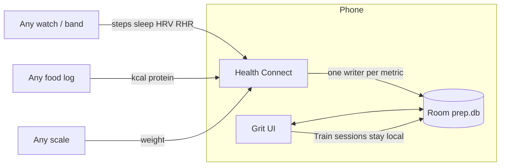

<div align="center">

```
 ██████╗ ██████╗ ██╗████████╗
██╔════╝ ██╔══██╗██║╚══██╔══╝
██║  ███╗██████╔╝██║   ██║
██║   ██║██╔══██╗██║   ██║
╚██████╔╝██║  ██║██║   ██║
 ╚═════╝ ╚═╝  ╚═╝╚═╝   ╚═╝
```

# Native Android prep tracker

**Log the session. Trust the week. Cut on rules, not vibes.**

Orange on charcoal. Loads in **lb**. Scale in **kg**. Data stays on the phone.

[](#build)
[](#build)
[](#data)
[](LICENSE)

</div>

---

<table>
<tr>
<td align="center" width="20%"><b>Today</b><br/>one call, then the log</td>
<td align="center" width="20%"><b>Train</b><br/>v4 week in pounds</td>
<td align="center" width="20%"><b>Trends</b><br/>tap a day, read it</td>
<td align="center" width="20%"><b>Review</b><br/>the protocol speaks</td>
<td align="center" width="20%"><b>Plan</b><br/>sync, backup, import</td>
</tr>
</table>



## Five rooms

| | Tab | You get |
| :--- | :--- | :--- |
| 01 | **Today** | One line of advice. Weight, kcal, protein, sleep, steps, RHR/HRV. 7-day avg and trend. |
| 02 | **Train** | Standard or Compressed start. `-5` / `+5` lb. Tap to type. US plates on a 45 lb bar. Warm-up, drop, rest-pause, timed, L/R, supersets. Rest timer in the shade. Screen stays awake. |
| 03 | **Trends** | Drag a chart. Calendar-true gaps. Heatmap. Muscle ready / recovering / tired. Balance vs close-grip bench. Anchor 1RMs in lb. |
| 04 | **Review** | Sleep, anchors, rate of loss. Compressed vs Standard. Diet levers. |
| 05 | **Plan** | Health Connect. JSON backup. Strong / Hevy / FitNotes CSV. Ladder policy. 1RM formula. |

## Signature

```
LOADS     225 lb     gym plates, 5 lb jumps
SCALE      86.4 kg   Health Connect / tape
STEPS      Auto      one writer per day, never two apps summed
LOGIC      domain/   pure Kotlin, unit-tested
STORE      Room      prep.db on device, not the cloud
```

**Retention-Recomp Protocol v4** is the week: arms and side-delts, Standard or Compressed by trigger. Energy math is intake vs trend weight (7700 kcal/kg), not a copied TDEE from another app.

## Data

| In | Out |
| :--- | :--- |
| Whatever your watch, band, scale, or food log writes to Health Connect | Train sessions: **local only** |
| Manual tags beat sync | JSON backup you export |
| Pin a writer in Plan, or leave Auto | CSV in from Strong / Hevy / FitNotes |

Connect path: **Plan → Connect → Backfill 30 days**, then pick Movement and Food writers if you run more than one.

Grit never sums two apps for the same metric. Auto keeps the largest single writer that day.

## Build

JDK **17**. Android Studio, or:

```bash
.\gradlew.bat testDebugUnitTest assembleDebug
```

APK lands at `app/build/outputs/apk/debug/app-debug.apk`.

```
app/src/main/java/com/kishan/preptracker/
├── domain/     rules, ladders, 1RM, muscles, heatmap
├── health/     Health Connect + step source pick
├── data/       Room + backup codec
├── train/      rest notification
└── ui/         five tabs, orange theme
```

Tests live next to the ideas they pin down in `app/src/test/`.

<div align="center">

**Grit** · MIT · yours to run, fork, and log against

</div>
